I build high-performance agent infrastructure, native edge runtimes, and distributed web platforms,
from low-footprint desktop sidecars to real-time cognitive AI architectures.

## ⚡ Agent Infrastructure & Runtimes

- [**dsh-bun**](https://github.com/evinelias/dsh-bun): Zero-Node, Zero-Electron DeepSeek Harness distribution running on Bun + Elysia + Tauri v2. 5× lower idle RAM, sub-100ms startup.
- [**cvc-ai**](https://github.com/evinelias/cvc-ai): Cognitive Version Control — git-style temporal branch and checkpointing for AI agent memories.
- [**shapemind**](https://github.com/evinelias/shapemind): Structured semantic reasoning engine and schema distillation for LLM agent loops.

## 🩺 High-Reliability Healthcare & Civic Systems

- [**ARISTO-CARDIO-COMPANION**](https://github.com/evinelias/ARISTO-CARDIO-COMPANION): Real-time cardiovascular monitoring, diagnostics, and companion telemetry platform.
- [**pts**](https://github.com/evinelias/pts): Political ticketing, high-concurrency grievance dispatch, and field resolution engine.
- [**lie.watch**](https://github.com/evinelias/lie.watch): Real-time claims verification, transcription, and contextual NLP fact-checking.

## 🌐 Full-Stack Platforms & Distributed Web

- **Enterprise Education & Learning**: Scaled production portals and real-time student evaluation systems (`Omkar ICSE`, `Omkar CBSE`, `AIAAI`).
- **High-Throughput Web Portals**: Modern responsive multi-tenant web applications built on Next.js, Bun, and PostgreSQL.

*Compiled native for things that must stay light, TypeScript for everything shipped by Friday.*

<picture>
  <source media="(prefers-color-scheme: dark)" srcset="https://raw.githubusercontent.com/evinelias/evinelias/output/github-snake-dark.svg" />
  
</picture>

